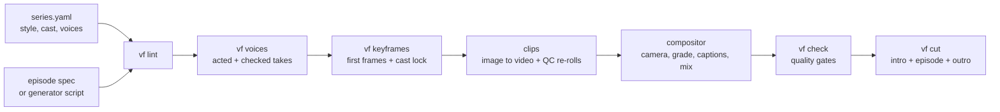

<div align="center">

# 🎬 videoforge

**Turn a script into finished, platform-ready episodes: YouTube 16:9 and Shorts / Reels 9:16.**
**Open models only, running on your own GPU.**


[](LICENSE)

<a href="docs/media/showreel.mp4"></a>

<sub>Made end to end by videoforge on one 8 GB laptop GPU: script, AI shots, original music, grade and titles. Open models only, no stock footage. ▶ <a href="docs/media/showreel.mp4">Watch with sound</a> · spec: <a href="series/showreel/reel/episode.yaml">series/showreel/reel/episode.yaml</a></sub>

[Features](#-features) · [How it works](#-how-it-works) · [Styles](#-supported-styles) · [Setup](#️-setup) ·
[Verify](#-verify-the-install) · [Create](#-create-a-series-and-an-episode) · [Release](#-render-check-release) ·
[Watermark](#-watermark) · [MCP](#-mcp-server-let-an-ai-agent-run-the-studio) · [Judges](#️-judges) · [Titles](#️-title-sequences-intro--outro) · [Timings](#️-timings) · [Cloud](#️-running-in-the-cloud) · [Claude Code](#-working-with-claude-code) ·
[Reference](#-reference) · [License](#-license)

</div>

---

## ✨ Features

| | |
|---|---|
| 🔌 **MCP server** | Any AI agent (Claude Code, Claude Desktop, ...) can write, render, check and judge videos through 21 tools. |
| 📝 **Script to screen** | Describe a series once in YAML, write each episode as a spec (or a small generator script) and build. |
| 🎭 **Consistent characters** | A cast sheet locks each character's face across every shot and episode, checked by face similarity. |
| 🗣️ **Acted voices** | Every line is acted several times, transcribed and scored; only a take that passes every gate is used. |
| 👄 **Talking shots** | Audio-driven acting with lip-sync; cut points are chosen so no mouth moves without a voice. |
| 🎥 **Film-like camera** | Eased dolly, pan, orbit and handheld moves, motion blur and 2.5D depth parallax in the compositor. |
| 🧪 **Automatic quality gates** | Smears, jitter, frozen or black frames, lip-sync offset, floating props, loudness and safe-area text. |
| ⚡ **Cached everywhere** | AI material is made once; editing one shot re-renders only that shot (a 60 s episode in ~30 s per format). |
| 🎞️ **Title sequences** | 3D photo-card intros and outros with titles, a production card and a watermark, CPU only. |
| ⚖️ **Judges** | Open-model judges for scripts, dialogue, music, clips and stills, plus blind critic rubrics: `vf judge`. |
| 📦 **Release cut** | Intro + episode + outro joined, checked and exported, plus a phone-size copy. |

---

## 🧭 How it works



Each stage is cached on disk, so a re-run only redoes what changed. Each AI stage runs in its own Python
environment and hands back files, so a crash in one model never takes the build down.

---

## 🎨 Supported styles

Pick a style per series or per episode (`style:`), or add your own to `styles/styles.yaml`. Each style sets the prompt
wording, the colour grade, the motion timing and the default camera. The risk column says how likely small 8 GB models
are to produce visible artifacts in that look. List them any time with `python -m vf styles`.

| Style | Look | 8 GB artifact risk |
|---|---|---|
| `anime` | Anime, high-speed dynamic tracking | high |
| `neo_noir` | Neo-noir cinema: chiaroscuro, wet asphalt | medium |
| `comic` | Comic book / graphic novel: inked outlines, halftone | low |
| `realistic` | Hyper-realistic cinematic live action, anamorphic | very high |
| `realistic_scenic` | Realistic without people words: landscapes, space, vehicles, objects | medium |
| `clay3d` | Modern 3D animation: clay render, soft ambient occlusion | low |
| `isometric` | Isometric diorama: 45-degree tilt-shift miniature | low |
| `cyberpunk` | Neon synthwave: chromatic aberration, laser trails | medium |
| `ink_wash` | Traditional sumi-e: brush strokes, watercolour bleed | very low |
| `papercraft` | 2.5D papercraft stop-motion: layered paper cut-outs | very low |
| `pixel` | Retrowave pixel art: hi-fi pixel grid | low |

Output formats (`python -m vf formats`): `yt` 1920x1080, `short` 1080x1920, `yt4k` 3840x2160.

---

## 🛠️ Setup

### 1. What you need
| Item | Used for |
|---|---|
| Windows 10/11 | the venv layout and helper binaries are Windows builds |
| NVIDIA GPU, 8 GB+ VRAM, recent driver | AI generation, CUDA compositing, NVENC encoding |
| Python 3.12 | the render environment and the 4 AI environments |
| ffmpeg 7+ on the PATH (or `VF_FFMPEG`) | encoding, muxing, loudness |
| ~150 GB free disk | model weights and the clip cache |
| git | cloning this repo and the model tool repos |

#### CPU only?
Partly. A machine without an NVIDIA GPU can render and release episodes from finished clips, slowly. Making new
AI media (voices, key frames, clips, lip-sync, music) needs the GPU.

| Part | CPU only | Notes |
|---|---|---|
| `vf lint`, script tools, editing specs | ✅ | no GPU code |
| title sequences (`vf.mograph`) | ✅ | CPU by design, ~4 min per 12 s at 1080x1920/60 |
| compositor in `vf build` | ⚠️ slow | NumPy instead of CUDA: ~110 s per 6 s shot vs ~1 s on the GPU (~19x slower) |
| encoding in `vf build` / `vf cut` | ✅ | libx264 / libx265 when NVENC is missing (`VF_ENCODER`) |
| voices, key frames, clips, lip-sync, music | ❌ | CUDA PyTorch models |

The compositor falls back to NumPy by itself when CuPy cannot start; `VF_GPU=0` forces it. Measured on the
demo episode (60 s, 540x960 preview): GPU + NVENC 9 s; CPU + libx264 12 min 44 s.
CPU-encoded segments get their own cache key, so they never mix with NVENC ones.

### 2. Get the code and the render environment
```bash
git clone https://github.com/hey24sheep/videoforge.git
cd videoforge
py -3.12 -m pip install -e .            # numpy, scipy, pillow, pyyaml, opencv, cupy-cuda12x; adds the `vf` command
```
`vf.cmd` in the repo root also runs `python -m vf` from any folder.

### 3. Create the AI environments
The AI stages live in separate venvs, so their torch versions never clash. The exact package lists are in `setup/`.

| venv | Runs | Torch build |
|---|---|---|
| `gen` | key frames, video clips, image edits, judge, depth, upscaling | cu128 |
| `tts` | voices and their checks | cu124 |
| `talk` | talking shots (InfiniteTalk via Wan2GP) | cu128 |
| `music` | music (ACE-Step 1.5) | cu128 |
| `judge` | optional: acting judge for voice takes (Step-Audio-2-mini, 4-bit) | cu126 |

First pick one folder for all AI venvs, tools and models, the **AI root**, and tell videoforge where it is:
```bash
setx VF_AI_ROOT "E:\ai"                 # any folder; default D:\claude_work\hero_film. Open a new terminal after setx.
```
Then create the venvs inside it:
```bash
py -3.12 -m venv %VF_AI_ROOT%\tools\envs\gen
%VF_AI_ROOT%\tools\envs\gen\Scripts\pip install -r setup/requirements-gen.txt --extra-index-url https://download.pytorch.org/whl/cu128
# repeat for tts (use .../whl/cu124), talk, music, and optionally judge (.../whl/cu126)
```
Every path below is relative to the AI root, written `<AI_ROOT>`. All stages, tools and model paths follow
`VF_AI_ROOT`; the variables in [Configuration](#configuration) override single paths.

### 4. Tool repos and binaries (under `<AI_ROOT>/tools/`)
| Folder | Source |
|---|---|
| `wan2gp/` | github.com/deepbeepmeep/Wan2GP (talking shots) |
| `ACE-Step-1.5/` | github.com/ace-step/ACE-Step-1.5 (music) |
| `musetalk/`, `latentsync/` | MuseTalk and LatentSync (older lip-sync path) |
| `rife/` | rife-ncnn-vulkan (frame interpolation), or set `VF_RIFE` |
| `esrgan/` | realesrgan-ncnn-vulkan (anime upscaler), or set `VF_ESRGAN` |

Some code imports `gguf` from a local folder: `py -3.12 -m pip install --target .pydeps gguf==0.19.0`.

### 5. Model weights
Weights download from Hugging Face on first use into `VF_HF_HOME` (default `<AI_ROOT>/models/hf`). To fetch the
quality video model up front: `<gen python> -m vf.gen.fetch_models`. The models used are listed in
[docs/reference.md](docs/reference.md) (Models).

### Configuration
`vf config` lists every setting with its value and where it came from. `vf config set VF_ENCODER cpu` saves a value
to `vf.config.json` (not committed); an environment variable wins over the file.

| Variable | Default | What it sets |
|---|---|---|
| `VF_AI_ROOT` | `D:\claude_work\hero_film` | root of the AI venvs (`tools/envs/`), tools (`tools/`) and models (`models/`) |
| `VF_GEN_PYTHON` | `<AI_ROOT>/tools/envs/gen/Scripts/python.exe` | interpreter of the `gen` venv |
| `VF_TTS_PYTHON` | `<AI_ROOT>/tools/envs/tts/Scripts/python.exe` | interpreter of the `tts` venv |
| `VF_HF_HOME` | `<AI_ROOT>/models/hf` | Hugging Face model cache |
| `VF_FFMPEG` | a local ffmpeg build | ffmpeg used by the clip generator |
| `VF_RIFE`, `VF_ESRGAN` | `<AI_ROOT>/tools/...` | interpolation and upscaler binaries |
| `VF_GLOBAL_CACHE` | `./cache` | shared cache of AI clips, voices, stills |
| `VF_ALLOW_ENCODE` | off | allow loading text encoders for new prompts (needs ~20 GB free RAM) |
| `VF_GC` | `1` | `0` = skip the cache clean-up after a build |
| `VF_NO_CACHE` | off | `1` = ignore the disk caches |
| `VF_GPU` | `1` | `0` = NumPy instead of CUDA in the compositor (very slow) |
| `VF_WATERMARK` | `1` | `0` = no corner mark ([please keep it](#-watermark)) |
| `VF_ENCODER` | `auto` | `auto` = NVENC when it works, else CPU; `nvenc`; `cpu` = libx264 / libx265 |
| `VF_GEN_PERSIST` | `1` | `0` = one-shot model processes instead of the warm worker |
| `VF_TEMP_MAX` | `80` | °C: a job pauses when the CPU, GPU or RAM sensor reaches this ([thermal guard](#thermal-guard)) |
| `VF_TEMP_RESUME` | `70` | °C: a paused job resumes when every sensor is at or below this |
| `VF_THERMAL` | `1` | `0` = no thermal guard |

### Thermal guard
`vf thermal` shows the CPU, GPU and RAM temperatures. Every job started with `tools/jobwatch.py run` is watched: when a
sensor reaches `VF_TEMP_MAX` (80 °C) the job's whole process tree is suspended (`=== THERMAL pause` in the log) and
resumes at `VF_TEMP_RESUME` (70 °C). A step that takes the GPU lock also waits until the machine is cool, so runs
outside jobwatch are covered between steps. Without admin rights Windows exposes the GPU (nvidia-smi) and the ACPI
thermal zone, which reads lower than the CPU cores under load, and no RAM sensor. For the exact core and DIMM
temperatures run [LibreHardwareMonitor](https://github.com/LibreHardwareMonitor/LibreHardwareMonitor) with its web
server on (port 8085): `vf thermal` uses it when it answers (`VF_TEMP_LHM`).

---

## ✅ Verify the install

```bash
vf                                                             # the commands, grouped
vf doctor                                                      # interpreters, venvs, GPU, NVENC, ffmpeg, models, disk
vf status                                                      # running and recent jobs (--watch: live)
python -m vf lint  series/demo/ep01/episode.yaml               # spec check, no GPU
python -m vf build series/demo/ep01/episode.yaml --formats short --preview   # no AI models needed
python -m vf check series/demo/ep01/episode.yaml               # quality gates on the render
python -m vf.mograph render examples/titles/demo_titles.yaml   # title sequence, CPU only
python -m vf.mcp_server --help                                 # MCP server installed (pip install -e ".[mcp]")
```
Expected: `vf doctor` lists every item as ok; the demo writes `series/demo/ep01/out/demo_episode_01_short_preview.mp4` and
`qc_short.json`; `vf check` ends with `PASS`; the title example writes `examples/titles/out/demo_titles.mp4`.
The demo series uses only bundled images, a video loop and a music pad, so it tests the compositor without any model.

---

## 🧱 Create a series and an episode

### 1. The series
```text
series/<series>/
  series.yaml        # style, look, fonts, captions, characters, voices, cast lock, intro/outro, release name
  cast/              # 1-3 reference images per character (cast lock)
  <ep>/              # one folder per episode
```
Start from `series/demo/series.yaml`. Characters go under `characters:` (prompts use `{key}`), faces under `cast:`.

### 2. The episode
```bash
vf new <series> <ep> --no 1 --title "Pilot"      # scaffolds series/<series>/<ep>/<ep>_gen.py
```
Write the beats and lines in the generator script; it lays out shot lengths and line timings from the real voice
takes. To design shots with Claude, paste `prompts/director.md` with your premise: it returns a shot list, dialogue
with delivery notes, and music and sound cues as YAML. Every field is in [docs/reference.md](docs/reference.md).

### 3. Check the script before spending GPU time
```bash
python -m vf script-qa drafts/*.md --bible series/<series>/bible.md                 # local model rubric
python -m vf script-judge prompts --premise P.md --entry A=a.md --entry B=b.md --out judge/
python -m vf script-judge table judge/                                              # drama + logic score, ranking
```

### 4. Generate, step by step (each step is cached)
```bash
python -m vf lint      series/<series>/<ep>/episode.yaml                  # authoring mistakes that cause artifacts
python -m vf voices    series/<series>/<ep>/episode.yaml                  # acted, transcribed, scored takes + timings
python -m vf keyframes series/<series>/<ep>/episode.yaml --formats short  # first frames -> out/keyframes_sheet.jpg
```
Review `out/keyframes_sheet.jpg` before animating; pin a frame you like with `keyframe_seed:`. Or run the whole
path in one go: `vf run series/<series>/<ep>/<ep>_gen.py --until keyframes --detach`.

---

## 🚀 Render, check, release

```bash
python -m vf build series/<series>/<ep>/episode.yaml --formats yt --preview   # half resolution, 30 fps
python -m vf build series/<series>/<ep>/episode.yaml --formats yt,short       # final
python -m vf check series/<series>/<ep>/episode.yaml                          # exit 1 = blocked
vf cut series/<series>/<ep>/episode.yaml                                      # intro + episode + outro + phone copy
```
Outputs land in `series/<series>/<ep>/out/`. Captions are burned in: subtitles on 16:9, large word chunks on 9:16.

**Long jobs** survive a closed terminal when started through the job runner:
```bash
python tools/jobwatch.py run --name ep01 --resumable -- python -m vf build <episode.yaml> --formats short
python tools/jobwatch.py watch --id <id>      # waits for the next event: error, milestone, stall, end
python tools/jobwatch.py check                # status of every recent job
```

---

## 💧 Watermark

Every video videoforge renders carries a small `hey24sheep.com/videoforge` mark in the bottom-right corner: about
18 px tall at 1080p, 60 % white, out of the way of captions. Title sequences made with `vf.mograph` get the same mark.

> 🙏 **Please keep it on.** It is as small as it can be, and every video that carries it helps videoforge grow and
> stay maintained.

If you must turn it off:

| Where | How |
|---|---|
| command line | `vf build ... --no-watermark` (also `vf cut` and `vf run`) |
| environment | `VF_WATERMARK=0` |
| series / episode | `watermark: false` in `series.yaml` or `episode.yaml` |
| MCP | `watermark: false` on `build`, `run_pipeline`, `release_cut`, `render_titles` |

Your own mark instead: `watermark: {text: "your.site", size: 0.017, opacity: 0.6, margin: 0.02}` (sizes are fractions
of the frame's short side). Renders with and without the mark are cached separately, so switching costs nothing.

---

## 🔌 MCP server: let an AI agent run the studio

videoforge ships a [Model Context Protocol](https://modelcontextprotocol.io) server. Any MCP client (Claude Code,
Claude Desktop, other agents) can write, render, check and judge videos through tools. Describe the video you want in
plain words; the agent writes the episode, shows you the key frames, builds and checks it.

```bash
py -3.12 -m pip install -e ".[mcp]"      # adds the MCP SDK and the `vf-mcp` command
```

**Claude Code:** open the repo; `.mcp.json` registers the server automatically (approve it once).
**Claude Desktop / other clients:** add this to the client's MCP config:
```json
{ "mcpServers": { "videoforge": { "command": "vf-mcp" } } }
```
**Remote agent:** `python -m vf.mcp_server --http 8765` serves streamable HTTP on 127.0.0.1 (expose it through your
own tunnel and auth).

| Group | Tools |
|---|---|
| discover | `doctor`, `list_styles`, `list_series`, `read_file` |
| author | `write_file` (series/ and examples/ only, YAML validated), `new_episode`, `lint` |
| render (GPU jobs) | `keyframes`, `build`, `run_pipeline`, `check`, `release_cut`, `render_titles` |
| jobs | `job_status`, `job_log` |
| judge | `judge_music`, `judge_clip`, `judge_script`, `judge_dialogue`, `critic_prompts`, `critic_table` |

Resources: `videoforge://docs/readme`, `videoforge://docs/workflow`, `videoforge://docs/reference`,
`videoforge://styles`. Prompt: `make_video(idea, format, seconds)` starts the whole flow.

GPU tools return a job id at once and keep running if the client disconnects; the agent polls `job_status`. Paths
cannot leave the repo. Try it: *"Make a 15-second 16:9 video of a lighthouse in a storm, realistic style. Show me the
key frames before you build."*

---

## ⚖️ Judges

Every check is an open model, or a blind Claude critic with a fixed rubric. `vf judge` is the one front door:

| Command | Judges | Model |
|---|---|---|
| `vf judge script a.md b.md [--context ctx.md] [--ref approved.md]` | hook, stakes, reveal, tension, dialogue, ending... (12 yes/no) | Qwen3.5-9B rubric (`vf/gen/scriptqa.py`) |
| `vf judge dialogue take*.wav --text "line" [--direction "quiet, tired"]` | words heard, word error rate, same voice across takes, acting | faster-whisper, ECAPA, Step-Audio-2-mini |
| `vf judge music a.wav b.wav --target "what it should sound like" [--key]` | match to the brief, loudness curve, key / bpm | CLAP, ACE-Step LM |
| `vf judge clip shot.mp4 --q "Is there a person?=no"` | yes/no questions + a description of what happens | Qwen3-VL (`vf/gen/judge.py`) |
| `vf judge image still.png --q "..."` | the same, on one picture | Qwen3-VL |
| `vf judge video episode.yaml [--video cut.mp4]` | brightness dips, frozen frames, lip-sync, loudness | `vf check` |

**Blind critics** for scripts, dialogue and video takes (rubrics in `prompts/judges/`):
```bash
vf judge critics script --entry v1=a.md --entry v2=b.md --context brief.md --out judge/
# run one fresh Claude subagent per judge/<critic>.prompt.txt (Opus, Sonnet), save replies as judge/<critic>.answer.md
vf judge table judge/          # per-entry mean over critics and criteria, plus the lowest criterion
```
Entries are relabelled A, B, C in a different order for each critic; the score is derived from the criteria, never
typed as one number. For a full A/B review of a re-cut against an approved cut, use `python -m vf.qa` (see
`docs/review_workflow.md`).

---

## 🎞️ Title sequences (intro / outro)

`vf/mograph.py` renders motion-graphics titles: photos and documents as cards floating in 3D, a drifting camera, depth
fog, dust and grain, two-line titles (a small white line over a big accent line), a cut-out figure, a production-house
card and a watermark. It runs on the CPU, so it also works without a GPU.

```bash
python -m vf.mograph render examples/titles/demo_titles.yaml
```
Copy `examples/titles/demo_titles.yaml` and change the cards, titles, `house:` card, `watermark:` and `music:`.
Every field is described at the top of `vf/mograph.py`.

---

## ⏱️ Timings

Measured on one laptop: RTX 4060 Laptop 8 GB (55 W), 31 GB RAM, Windows 11. A desktop GPU is faster.

| Step | Time |
|---|---|
| key frame, Z-Image-Turbo INT8 (576x1024) | ~11-13 s |
| AI clip, Kandinsky 6 Lite, 5 s at 384x672 (`k6` profile) | ~1.3 min |
| AI clip, LTX-2.5 distilled, 4 s at 384x704 (`gen: {engine: ltx}`) | ~50 s (first run downloads ~30 GB) |
| clip finishing: deblur, frame interpolation to 60 fps, 4x upscale | ~30 s per clip |
| talking shot, InfiniteTalk (one 81-frame window) | ~5.5 min |
| music, ACE-Step 1.5 turbo | ~3.5 min model load, then ~11 s per 30 s of audio |
| compositor: 60 s at 1080p60, 16:9 + 9:16 | 41 s cold, ~6 s when cached |
| demo episode preview (60 s, 540x960), GPU + NVENC | 9 s |
| same, CPU only (NumPy + libx264) | 12 min 44 s |
| title sequence, `vf.mograph` (12 s at 1080x1920/60, CPU) | ~4 min |
| README showreel from scratch (15 s, 4 AI shots, 1080p60) | 14.4 min (+ ~4 min music, ~2 min key frames) |

Everything is cached: a rebuild after a spec edit renders only what changed.

---

## ☁️ Running in the cloud

A cloud machine without the NVIDIA GPU and the model weights can still do a lot:

| Works in the cloud | Needs the GPU machine |
|---|---|
| writing and judging scripts (`script-judge`, story skills) | voices, key frames, clips, talking shots |
| editing specs, generator scripts, docs | `vf build`, `vf cut`, `vf check` |
| `vf lint` | music generation |
| title sequences with `vf.mograph` (`pip install numpy opencv-python-headless pillow pyyaml`, ffmpeg) | |
| a cloud agent driving the GPU machine through the MCP server (`python -m vf.mcp_server --http 8765` on the GPU machine, behind your own tunnel and auth) | |

Work in the cloud, push, pull on the GPU machine, run the build there.

---

## 🤖 Working with Claude Code

The repo is set up for Claude Code sessions:
- `CLAUDE.md`: the rules every session follows (workflow gates, model limits, reply style).
- `STATE.md`: the current working state; read it first, update it after each decision.
- `.claude/skills/`: skills for this project (script doctoring, story planning and review, writing craft, a short
  reply style). The story and writing skills are third-party, Apache-2.0; see the licence file in that folder.
- `.claude/memory/`: the memory bank: standing rules and lessons learned. Read `.claude/memory/MEMORY.md` at the
  start of a session; add each new lesson as one file plus one index line.
- `.mcp.json`: registers the videoforge [MCP server](#-mcp-server-let-an-ai-agent-run-the-studio), so Claude can
  call `build`, `keyframes`, `judge_*` and the other tools directly instead of shell commands.

---

## 📚 Reference

| Topic | Where |
|---|---|
| Episode spec fields, cast lock, camera, caching, quality gates, models | [docs/reference.md](docs/reference.md) |
| The ordered path from script to delivered Short, with every gate | [docs/workflow.md](docs/workflow.md) |
| Review process and scoring | [docs/review_workflow.md](docs/review_workflow.md) |
| Video model choices and speeds | [docs/video_model.md](docs/video_model.md) |
| Precision and speed measurements | [docs/model_optimization_plan.md](docs/model_optimization_plan.md) |
| Changes by version | [CHANGELOG.md](CHANGELOG.md) |

### Repository layout
```text
vf/            pipeline: build, render, checks, cut, title sequences (mograph.py), judges (judge.py),
               MCP server (mcp_server.py), encoder choice (enc.py); AI stages in vf/gen/
tools/         job runner, music, precision benches, helpers
styles/        style profiles          prompts/   episode-design prompts, judge rubrics (prompts/judges/)
series/        one folder per series   examples/  title-sequence example
setup/         package lists of the AI environments
docs/          workflow, reference, model notes
.claude/       skills and memory bank for Claude Code          .mcp.json   MCP server registration
```
Not in git: renders (`out/`), caches (`cache/`, `.vfcache/`), job logs, QA renders, model weights and other media
(see `.gitignore`).

---

## 📜 License

Apache License 2.0: see [LICENSE](LICENSE) and [NOTICE](NOTICE). Use it, change it, sell what you make with it.
If you redistribute videoforge or a fork of it, keep the NOTICE file and credit **videoforge by hey24sheep**
([hey24sheep.com/videoforge](https://hey24sheep.com/videoforge)).

AI models, tools and packages installed during setup keep their own licences; check each model card before
commercial use. The creative-writing skills in `.claude/skills/` are third-party, Apache-2.0.
